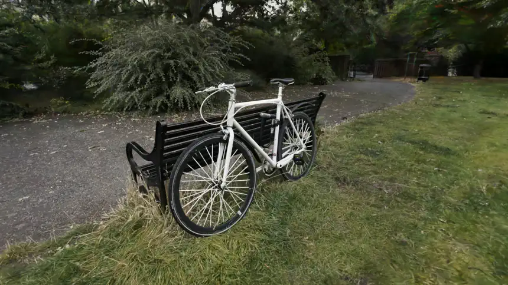
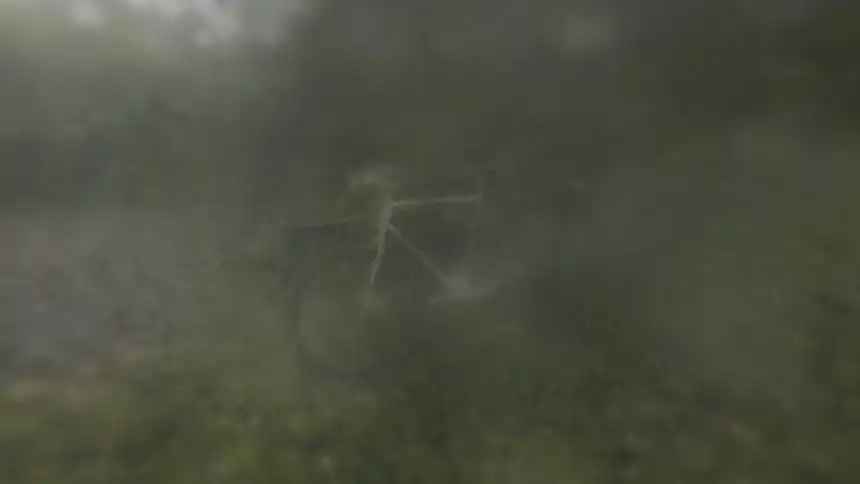
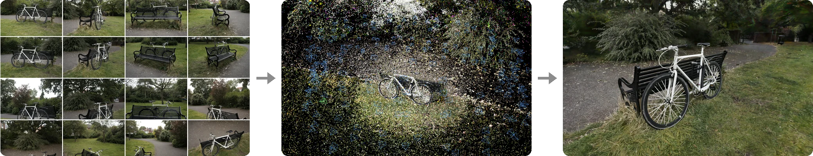
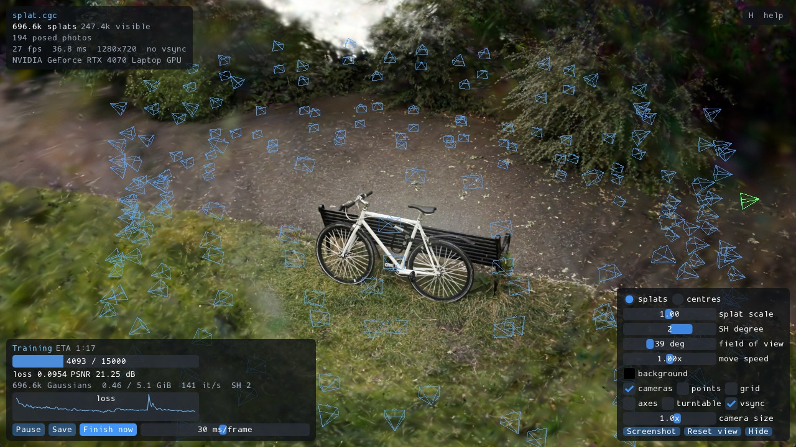

<h1 align="center">vibe-splat</h1>

<p align="center">
  <b>Turn a handful of photos into a 3D scene you can walk around in, on whatever GPU you have.</b>
</p>

<p align="center">
  <a href="https://github.com/P-i-N/vibe-splat/actions/workflows/ci.yml"></a>
  
  
  <a href="LICENSE"></a>
</p>

<p align="center">
  
</p>

Point your camera at something, walk around it, and give `vibe-splat` the photos
or the video. A few minutes later you have a photoreal
[Gaussian splat](https://repo-sam.inria.fr/fungraph/3d-gaussian-splatting/)
you can fly through in real time, with every leaf and spoke in place.

It's one small program. No CUDA, no Python, no 10 GB toolkit to install: just
Vulkan, so it runs the same on AMD, nVidia and Intel, on Windows and Linux.

## Why vibe-splat

- **🎮 Runs on any modern GPU.** Pure Vulkan from start to finish. It runs on a laptop, a desktop or a Steam Machine.
- **📦 One 4 MB executable.** Download it, run it. There's nothing to install
  and no Python environment to fight with.
- **📸 Photos or video in, 3D out.** It finds the camera positions itself,
  trains the scene and writes a standard `.ply` that other splat tools open.
- **👀 Watch it learn.** The viewer shows the scene sharpening while it trains,
  along with every photo floating where it was taken.
- **🌐 Share with one file.** Each scene also comes out as a single `.html`
  page. Send it to anyone and they open it in a browser, with nothing to install.
- **🗜️ Tiny scenes.** Its own `.cgc` format is about 28x smaller than `.ply`
  and looks nearly the same.

## Watch it learn

<p align="center">
  
</p>

From fog to fine detail: snapshots from a single 74-second training run on a Steam Machine, from 194 photos.

## From photos to 3D in three commands

```bash
splat ingest my_photos/ -o garden/   # photos, videos, or both
splat sfm garden/                    # work out where each photo was taken
splat train garden/ --view           # train it while you watch
```

That's all it takes. `garden/` now holds `splat.ply`, the compact `splat.cgc`
and `splat.html`, ready to send. To look at it again later, double-click
`splat` and drop the folder onto its window.

<p align="center">
  
  <br>
  <sub><b>Photos</b> &nbsp;→&nbsp; <b>Camera poses</b> &nbsp;→&nbsp; <b>3D scene</b></sub>
</p>

## Viewer

<p align="center">
  
</p>

Fly with WASD or orbit with the mouse. Jump into any photo to compare it with
the 3D scene, and watch the progress, loss and speed while it trains. The viewer
opens any standard 3DGS `.ply`, so scenes from other trainers work too.

## Get it

**Download:** the latest build of `splat-windows-x64.zip` (Windows) or
`splat-x86_64.AppImage` (Linux and SteamOS) is on the
[CI page](https://github.com/P-i-N/vibe-splat/actions/workflows/ci.yml). All it
needs is a GPU driver with Vulkan 1.3.

**Build it yourself:**

```bash
git clone --recursive https://github.com/P-i-N/vibe-splat
cd vibe-splat
cmake --preset linux-release        # or windows-release
cmake --build --preset linux-release
```

## Learn more

- [User guide](docs/guide.md): every command, the viewer's controls, importing
  video, compression, the browser viewer and building from source.
- [How it works](docs/internals.md): the structure from motion, the trainer and
  the renderer, all written from scratch for Vulkan.

## License

[0BSD](LICENSE): use it for anything, no conditions, no attribution needed.

<sub>The bicycle scene is from the
[Mip-NeRF 360](https://jonbarron.info/mipnerf360/) dataset by Barron et al.</sub>
